# OpenMR2 - MegaRace 2 Revived

A recreation of MegaRace 2 for modern Windows and Linux systems, using the
original game data without DOSBox. Current development version: **0.7.15-dev**.

**Requires your own English, French or German GOG installation of MegaRace 2.**
Original game files are not included. Original CD editions are not yet supported.

## Features and improvements

- Native Windows and Linux support.
- High-resolution rendering, optional 60 FPS, texture filtering and antialiasing.
- Sharper fonts, HUD graphics and icons.
- Real-time shadows, vehicle lights, enhanced explosions and damage effects.
- Custom texture packs and PNG texture dumping.
- Experimental video upscaling filters.
- Controller support and remappable controls.
- Separate volume controls for engines, effects and music.
- Video recording and screenshots.

## Retro and Revived comparisons

Actual OpenMR2 captures of deterministic test scenes. **Retro Mode is the port's
Retro renderer, not a screenshot of the original DOS executable.** Native
viewport/scaling choices differ between modes. Click an image for full size.

| Scene | Retro Mode | Revived Mode |
| --- | --- | --- |
| Race, HUD and fonts | 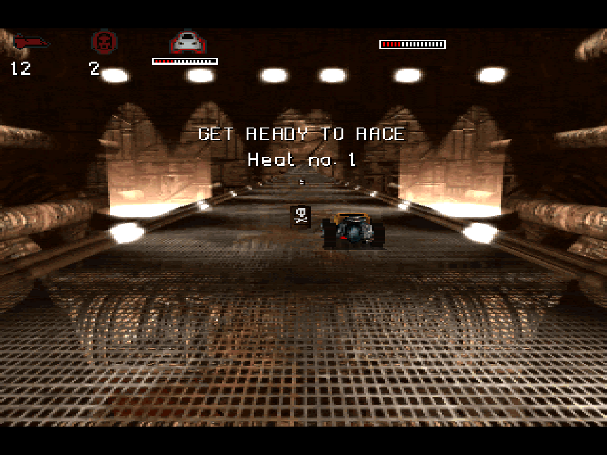 |  |
| Options and typography | 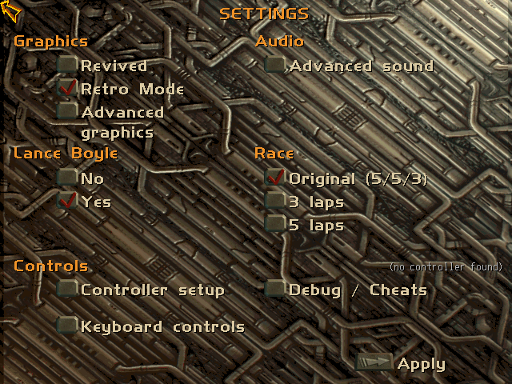 | 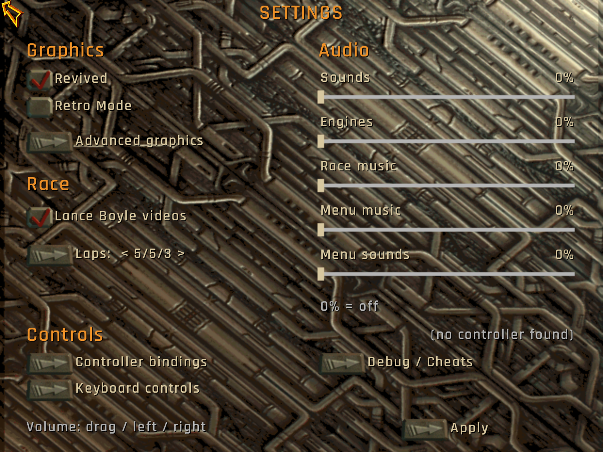 |
| Vehicle selection | 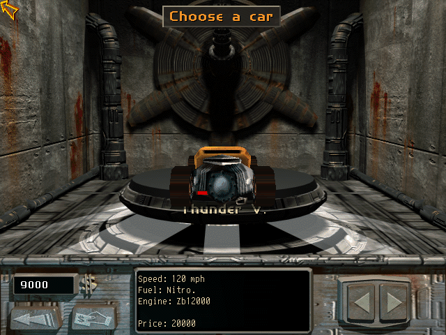 | 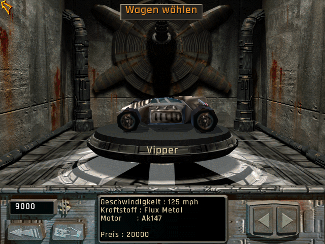 |

## Revived effects gallery

Actual in-engine effect test captures at default intensity; a still image shows
one point in an animated effect rather than its full movement.

| Explosion and debris | Contact sparks |
| --- | --- |
| 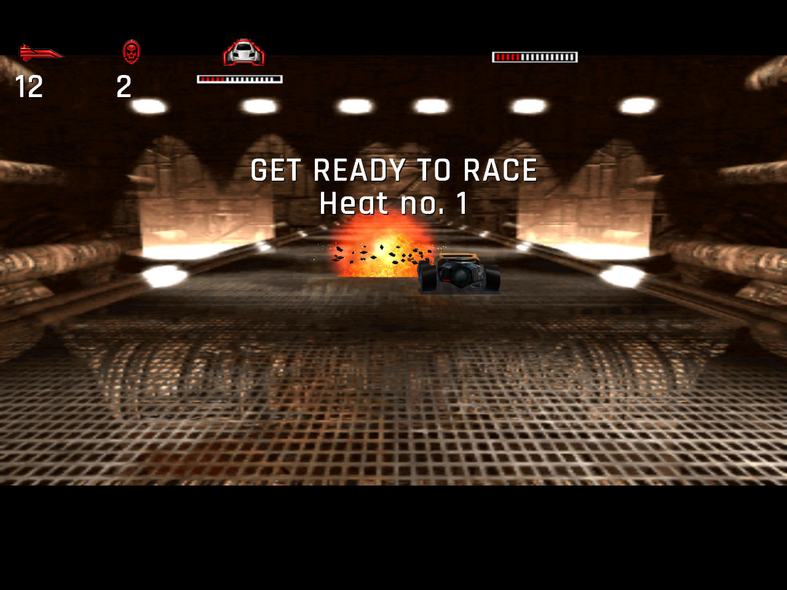 | 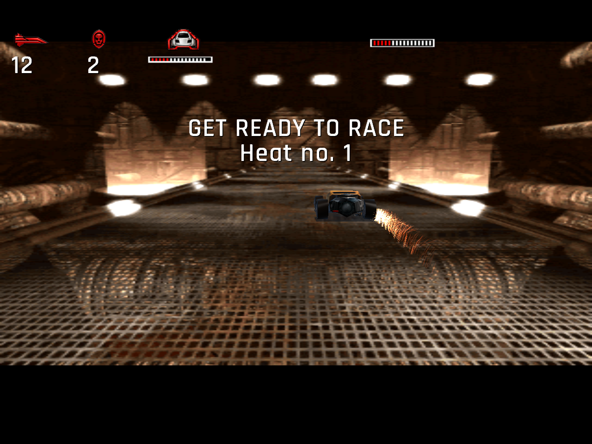 |

| Headlights on Blatt 96 | Brighter rear brake lights |
| --- | --- |
| 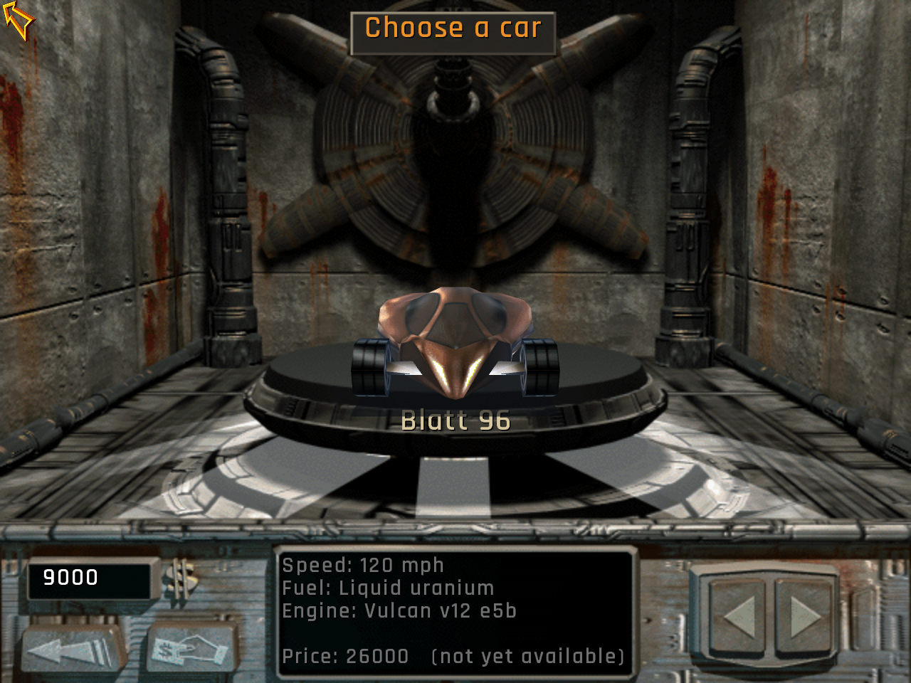 | 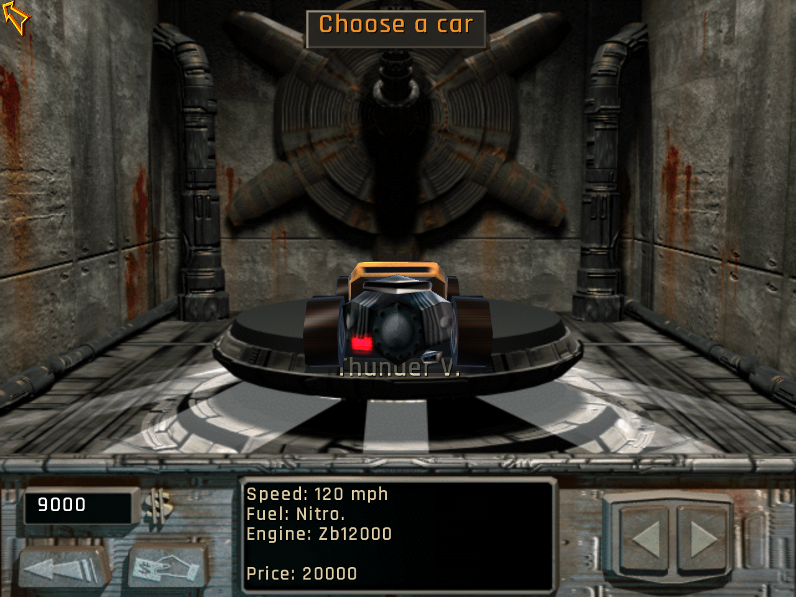 |

| Damage fire and smoke | Oil surface |
| --- | --- |
| 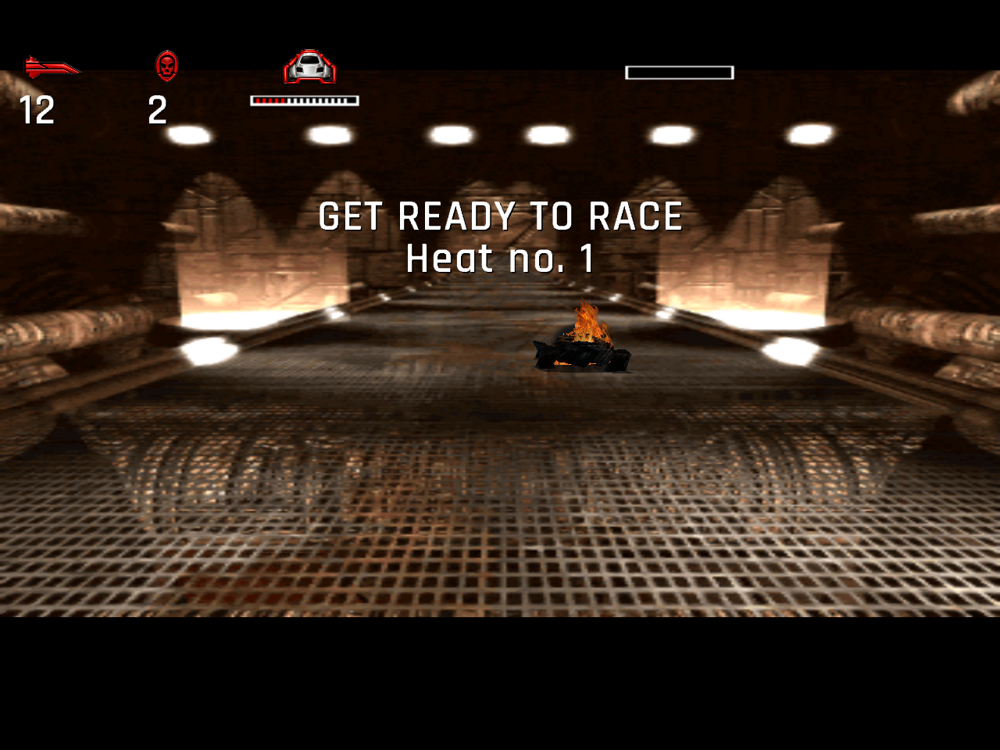 | 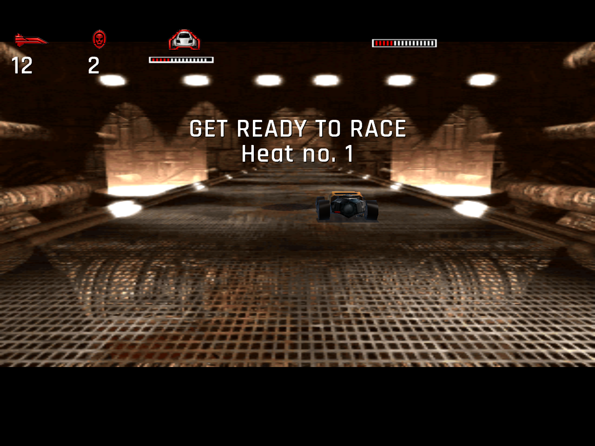 |

## Install a release

Download the appropriate **ZIP** from [Releases](https://github.com/nex86/openmr2/releases).
The separate **source.tar.gz** is for developers. Development versions are
prereleases; availability depends on the current release publication status.

### Windows x64

1. Extract `OpenMR2-0.7.15-dev-Windows-x64.zip` to a writable folder.
2. Run `OpenMR2.exe` from the extracted directory. Windows 10/11 x64 and an
   OpenGL 3.3-capable graphics driver are the intended target; no Visual C++
   runtime installation is required.
3. Choose your MegaRace 2 GOG installation if prompted, then choose Revived or
   Retro Mode. Both choices can be remembered for the next launch.

Game files beside OpenMR2.exe are detected first. Otherwise the selected path
is stored in `revived_config/openmr2_setup.cfg`. Initial verification has a
progress dialog; subsequent starts check required-file presence without hashing.

For F11 recording, install a suitable [FFmpeg](https://ffmpeg.org/download.html)
build with libx264 and AAC and make `ffmpeg.exe` available in PATH, or place it
in `tools/ffmpeg.exe` beside OpenMR2.exe. It is optional and not included in these ZIPs.

### Linux x86_64

The native ZIP uses host libraries. Ubuntu 24.04 or a comparable distribution
with glibc 2.39+, X11/Xwayland and OpenGL 3.3 is the tested baseline. On Ubuntu:

```sh
sudo apt install unzip libx11-6 libgl1 libgl1-mesa-dri libpulse0 libstdc++6
unzip OpenMR2-0.7.15-dev-Linux-x86_64.zip
cd OpenMR2-0.7.15-dev-Linux-x86_64
chmod +x openmr2_linux
./openmr2_linux --game "/path/to/MegaRace 2"
```

Audio uses PulseAudio or PipeWire's PulseAudio compatibility service. The startup
mode dialog is provided on Linux as well. This native ZIP writes settings and
captures under `revived_config` in its launch directory, so start it from the
extracted folder as shown above. The separately built AppImage uses XDG storage.
Optionally install `ffmpeg` for F11 recording; screenshots need no encoder.

## Keyboard shortcuts

| Key | Action |
| --- | --- |
| F1 | Switch Revived / Retro Mode |
| F2 | Toggle Revived texture/background filtering |
| F3 | Switch Original / 60 FPS in Revived |
| F4 | Toggle custom textures in Revived |
| F5 | Cycle Retro output filters |
| F6 | Cycle Retro scaling 1x-4x |
| F7 | Toggle experimental video upscaling in Revived |
| F8 | Cycle FSR / HQ4x / 4xBR / Lanczos3 |
| F9 | Mute/restore all six Revived effect groups |
| F10 | Full mode-specific options; Apply/Esc returns to the same scene |
| F11 | Start/stop H.264/AAC MP4 recording |
| F12 | Save a quality-98 JPEG screenshot |
| Alt+Enter | Windows fullscreen toggle; Linux uses its menu setting |
| Up / Down, Left / Right | Accelerate/brake and steer in races; navigate menus |
| Space / Enter | Front / rear weapon in a race; activate menu controls |
| Tab / / | Switch front / rear weapon slot |
| Esc or P | Pause/resume race; Esc also returns from menus/viewers |

Mode-specific shortcuts respect Retro's restrictions. See the
[complete controls list](DOCUMENTATION.md#keyboard) for shop, save/load, replay, cinematic,
Extras and model-viewer controls.

## Build and run

Windows x64 requires LLVM Clang/LLD and PowerShell:

```powershell
./build_windows.ps1
./build/OpenMR2.exe
```

Linux x86_64 requires a C++17 compiler and X11 development headers:

```sh
sudo apt-get install g++ libx11-dev
sh build_linux.sh
./build/openmr2_linux --game /path/to/MegaRace2
```

At runtime an OpenGL 3.3-capable driver is needed. Linux uses X11/Xwayland and
PulseAudio or PipeWire's PulseAudio compatibility server. Windows can find the
game files beside the executable or prompt for the installation directory.
See the [build instructions](DOCUMENTATION.md#building) for toolchains and the separate original-data
tests. CI compiles without fetching or uploading proprietary game data.

## Documentation

[OpenMR2 Documentation](DOCUMENTATION.md) covers settings, controls, graphics,
troubleshooting, development notes and licensing. Texture-pack instructions
are also available in [custom_textures.txt](custom_textures.txt).

## Licensing and status

Independently created project code is offered under **GPL-3.0-only**, within
the contributors' rights. Dependencies retain their own licenses. The direct
original-executable decoder translation and the AI-edited original artwork have
separately documented unresolved redistribution questions; this is not a claim
that every file is independently authored or uniformly cleared under GPL.

This is an unofficial project with no asserted affiliation or endorsement by
the original game's rightsholders. Do not submit original game files, extracted
assets, personal configuration or saves to the repository or its issues.

Source and binary downloads are separate; see [distribution layout](DOCUMENTATION.md#distribution).
